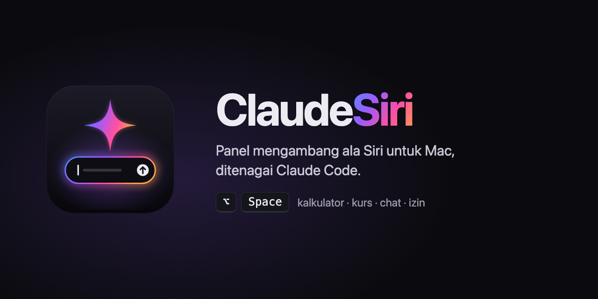
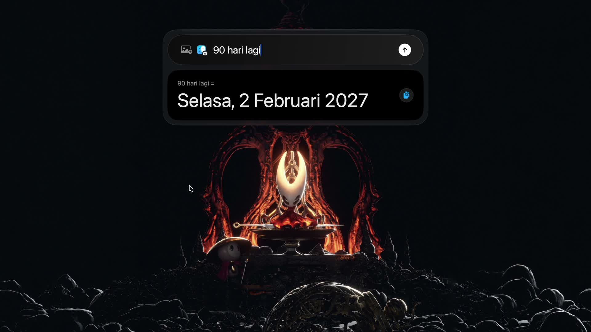
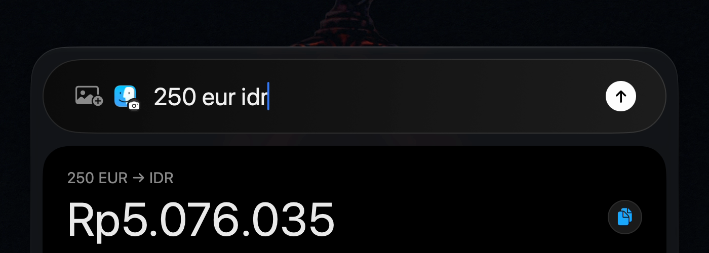
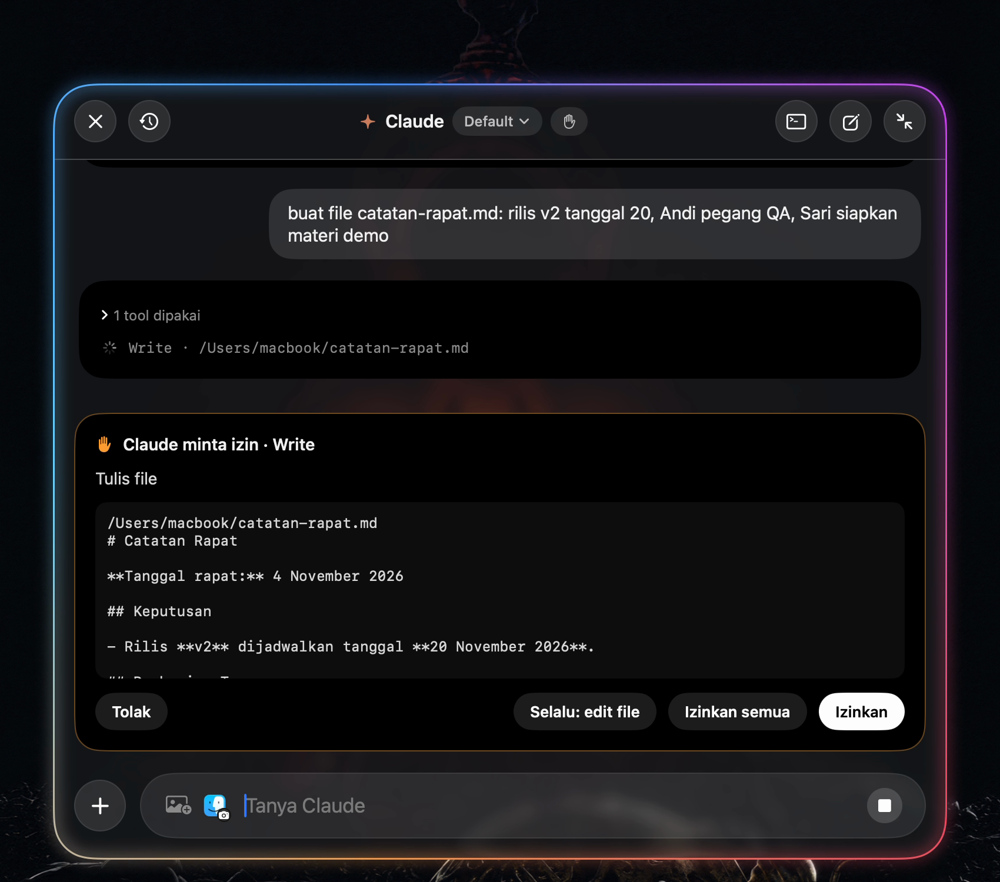

<p align="center"></p>

# ClaudeSiri

Panel mengambang ala Siri untuk Mac yang ditenagai **Claude Code**. Tekan **⌥Space** di app mana pun, ketik atau ucapkan pertanyaan, dan jawabannya muncul di kartu kecil di atas layar. Hitungan dan kurs dijawab di tempat, tanpa menunggu AI.

[](media/demo.mp4)

> Video demo: [`media/demo.mp4`](media/demo.mp4) (95 detik, direkam langsung dari app, tanpa editing selain mempercepat satu jeda).

| Kalkulator lokal | Jawaban Claude | Kartu izin |
|---|---|---|
|  |  |  |

## Fitur

**Panel**
- Dibuka dengan **⌥Space** dari app mana pun, atau **⌥⇧Space** untuk langsung bicara.
- Ada dua mode. Mode kecil berupa pill input dan kartu jawaban. Mode besar (**⌘E**) berupa chat penuh dengan riwayat.
- Panel bisa digeser dan posisinya diingat. Muncul di semua Space dan di atas app layar penuh.
- Di macOS 26 memakai efek **Liquid Glass**, yang bisa dimatikan dari menu bar.

**Kalkulator lokal (tanpa memanggil Claude)**
- Paham format angka Indonesia: `1,5 jt / 4`, `250rb + 1,2jt`, `3jt - 15%`.
- Kurs hanya dikonversi kalau tujuannya disebut: `250 eur idr`, `18000000 idr usd`, `200 usd - 1000000 idr`. `100 usd` saja tidak dikonversi.
- Satuan: `5 km ke mil`, `30 c ke f`, `2 gb ke mb`, `120 m2 ke ft2`.
- Tanggal: `90 hari lagi`, `umur 12 mei 1995`, `1 jan sampai 4 nov`.
- Hasil muncul setelah kamu berhenti mengetik (0,5 detik). Klik tombol salin untuk menyalin angkanya.

**Claude**
- Jawaban di-stream langsung dari CLI `claude` memakai login claude.ai kamu, bukan API key.
- Jawaban dirender sebagai markdown: tabel, blok kode dengan tombol Salin, dan link yang bisa diklik.
- Bisa melampirkan gambar dengan tombol foto, tempel (⌘V), atau seret ke panel. Ada juga tombol **screenshot jendela** berupa ikon app yang sedang kamu pakai.
- Teks yang sedang kamu pilih di app lain otomatis ikut sebagai konteks (butuh izin Aksesibilitas).
- Input suara dengan pengenalan ucapan bahasa Indonesia atau Inggris. Pesan terkirim otomatis setelah kamu diam.
- Bisa memilih model (Opus, Sonnet, Haiku). Di bawah tiap jawaban ada statistik: durasi, token, dan biaya.
- Ada tombol stop yang menghentikan jawaban dengan rapi. Kalau panel tertutup, notifikasi muncul saat jawaban panjang selesai.
- Riwayat chat bisa dicari, termasuk sesi yang dimulai dari terminal. Bisa dilanjutkan di Terminal (`claude --resume`).

**Izin**
- Saat Claude mau mengubah sesuatu (Bash, Edit, Write), muncul kartu izin dengan pilihan **Tolak / Selalu: ‹aturan› / Izinkan semua / Izinkan**.
- **Selalu** menyimpan aturan sempit seperti `Bash(git status:*)`. Perintah gabungan dan berbahaya (`rm`, `sudo`, `&&`, `|`) tidak pernah diusulkan jadi aturan.
- Ada tiga mode izin, yang bisa diganti di header atau menu bar dan langsung berlaku di tengah chat:

  | Mode | Perilaku |
  |---|---|
  | Tanya dulu | Kartu izin muncul untuk setiap tool yang mengubah sesuatu. |
  | Selalu izinkan (**Auto**) | Semua permintaan disetujui otomatis oleh app. |
  | Lewati semua izin (**Bypass**) | Sama dengan `--dangerously-skip-permissions`. |

## Pintasan

| Tombol | Fungsi |
|---|---|
| ⌥Space | Buka/tutup panel |
| ⌥⇧Space | Langsung bicara |
| Enter | Kirim (hitungan dijawab lokal, sisanya ke Claude) |
| ⌘Enter | Izinkan permintaan / paksa kirim ke Claude |
| Esc | Tolak izin → stop → tutup |
| ⌘E | Mode besar/kecil |
| ⌘N | Chat baru |
| ⌘Y | Riwayat |
| ⌘T | Lanjutkan di Terminal |
| ⌘A ⌘C ⌘V ⌘X ⌘Z | Edit seperti biasa (⌘V juga bisa menempel gambar) |

## Pasang

Yang dibutuhkan:
- macOS 14 atau lebih baru (efek kaca butuh macOS 26).
- Xcode atau Command Line Tools (Swift 5.9+).
- [Claude Code](https://docs.claude.com/en/docs/claude-code) terpasang dan sudah login (`claude` bisa dijalankan di terminal).

```sh
git clone https://github.com/zerodevid/claudesiri.git && cd claudesiri
./build.sh
```

`build.sh` melakukan build release, merakit `~/Applications/ClaudeSiri.app`, menandatanganinya, lalu menjalankannya. Saat pertama jalan, ClaudeSiri otomatis didaftarkan sebagai app login (bisa dimatikan dari menu ✦ › Jalan saat login).

Izin macOS yang diminta sesuai fitur yang dipakai:

| Izin | Untuk |
|---|---|
| Aksesibilitas | Menyertakan teks yang sedang dipilih |
| Screen Recording | Tombol screenshot jendela |
| Mikrofon + Pengenalan Ucapan | Input suara |

Kalau punya sertifikat **Apple Development**, `build.sh` memakainya untuk menandatangani app, jadi izin di atas tidak hilang setiap build ulang. Tanpa sertifikat, dipakai tanda tangan ad-hoc.

### Catatan

- ClaudeSiri membuang `ANTHROPIC_API_KEY`, `ANTHROPIC_BASE_URL`, dan `ANTHROPIC_AUTH_TOKEN` dari lingkungan proses `claude`, supaya yang dipakai login claude.ai dan bukan API key lama di `.zshrc`.
- Kalau `claude` tidak ketemu, set path-nya: `defaults write id.zerodev.claudesiri claudePath /path/ke/claude`.
- Folder kerja Claude default-nya home dan bisa diganti dari menu ✦ › Folder kerja.

## Cara kerja

```
⌥Space ─► FloatingPanel (NSPanel nonactivating + SwiftUI)
              │
              ├─ Calculator / UnitCalc ── jawab lokal (kurs open.er-api.com, kripto CoinGecko, cache 30 mnt)
              │
              └─ ClaudeRunner ── satu proses `claude -p` per chat
                    stdin : {"type":"user", message:{content:[teks, gambar]}}
                    stdout: stream-json → teks, tool, control_request can_use_tool
                    izin  : control_response allow/deny ← PermissionCard
                    kontrol: interrupt · set_model · set_permission_mode
```

| File | Isi |
|---|---|
| `ClaudeRunner.swift` | Proses CLI, protokol stream-json, izin, stop, ganti model/mode |
| `ChatModel.swift` | State chat, alur kirim, antrean izin, lampiran |
| `Views.swift` | Semua tampilan SwiftUI (mode kecil, mode besar, kartu, menu) |
| `App.swift` | Panel, hotkey Carbon, menu bar, notifikasi, shortcut |
| `Calculator.swift` · `UnitCalc.swift` | Kalkulator, kurs, satuan, tanggal |
| `Permissions.swift` | Aturan "selalu izinkan" dan mode izin |
| `History.swift` | Indeks sesi dan pembaca transkrip `.jsonl` |
| `ScreenContext.swift` | App depan, teks terpilih, screenshot jendela |
| `Speech.swift` | Input suara |
| `Markdown.swift` | Render markdown |
| `Recorder.swift` | Perekam layar untuk dokumentasi |

## Mode debug

```sh
.build/release/ClaudeSiri --calc "250 eur idr" "3jt - 15%"   # uji kalkulator di terminal
.build/release/ClaudeSiri --history                            # daftar sesi + isi sesi teratas
.build/release/ClaudeSiri --snapshot /tmp/snap                 # render state UI ke PNG
open -g -n ~/Applications/ClaudeSiri.app --args --record /tmp/demo.mov 120 --display 1
```

## Logo

Logo ada di [`assets/logo.svg`](assets/logo.svg). Isinya pill pencarian dengan border berpendar (warna yang sama dengan panel saat Claude bekerja) dan bintang empat sudut. `assets/AppIcon.icns` dibuat dari SVG itu dan dipasang oleh `build.sh`.

## Lisensi

[MIT](LICENSE) © 2026 Zero Dev. ClaudeSiri adalah proyek independen dan tidak berafiliasi dengan Anthropic maupun Apple. Claude adalah merek Anthropic; Siri adalah merek Apple.
