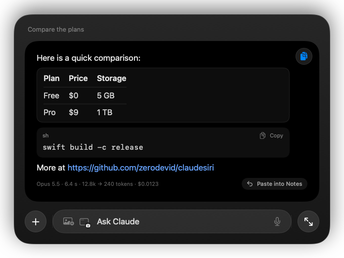
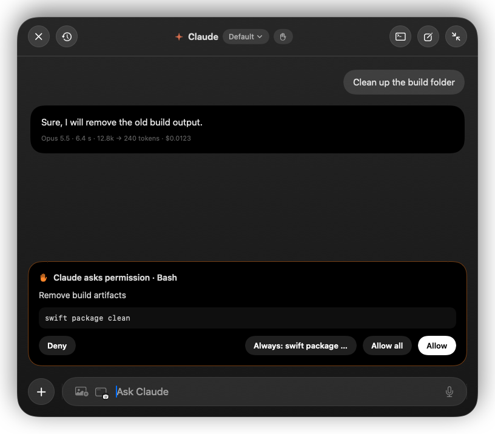
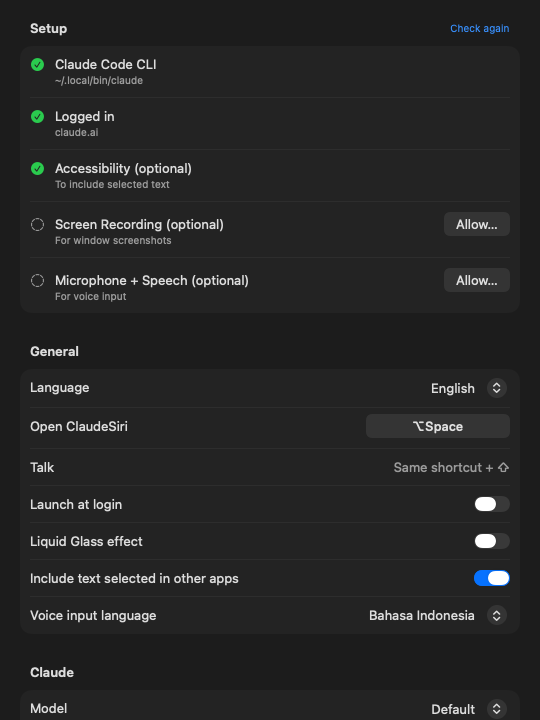

<p align="center"></p>

<p align="center"><a href="https://github.com/zerodevid/claudesiri/actions/workflows/ci.yml"></a> <a href="https://github.com/zerodevid/claudesiri/releases/latest"></a>  <a href="LICENSE"></a></p>

# ClaudeSiri

A Siri-style floating panel for the Mac, powered by **Claude Code**. Press **⌥Space** over any app, type or say your question, and the answer shows up in a small card at the top of the screen. Math and currency questions are answered on the spot, without waiting for the AI.

[](media/demo.mp4)

> Demo video: [`media/demo.mp4`](media/demo.mp4). It is 95 seconds, recorded straight from the app with the Indonesian UI, before Settings and the English UI existed. The only edit is one pause sped up.

| Local calculator | Claude's answer | Permission card | Settings |
|---|---|---|---|
|  |  |  |  |

## Features

**Panel**
- Open it with **⌥Space** from any app, or **⌥⇧Space** to start talking right away. The shortcut can be changed in Settings.
- Two modes. Compact mode is an input pill and an answer card. Expanded mode (**⌘E**) is a full chat with history.
- The panel can be dragged and remembers its position. It appears on every Space and above full-screen apps.
- Uses **Liquid Glass** on macOS 26. You can turn it off in Settings.
- English or Indonesian interface (follows the system language by default).

**Local calculator (no call to Claude)**
- Understands Indonesian number formats: `1,5 jt / 4`, `250rb + 1,2jt`, `3jt - 15%`. Here `rb` is thousand, `jt` is million, and `,` is the decimal separator.
- Converts currency only when a target is given: `250 eur idr`, `18000000 idr usd`, `200 usd - 1000000 idr`. `100 usd` on its own is not converted.
- Units: `5 km ke mil`, `30 c ke f`, `2 gb ke mb`, `120 m2 ke ft2`. `to` and `in` work as well as `ke`.
- Dates: `in 90 days`, `30 days ago`, `2 weeks from now`, and the Indonesian forms `90 hari lagi`, `umur 12 mei 1995` (age), `1 jan sampai 4 nov` (days between).
- The result appears once you stop typing (0.5 s). Click the copy button to copy the number.
- Numbers are formatted for the interface language (2,550,000 or 2.550.000).
- Rates are cached for 30 minutes. If they cannot be refreshed for more than 6 hours, the result says so.

**Claude**
- Answers stream straight from the `claude` CLI and use your claude.ai login, not an API key.
- Answers are rendered as markdown: tables, code blocks with a Copy button, and clickable links.
- You can attach images with the photo button, paste them (⌘V), or drop them on the panel. There is also a **window screenshot** button, shown as the icon of the app you are using.
- Text you have selected in another app is sent along as context (needs Accessibility permission).
- Voice input with Indonesian or English speech recognition. The message is sent automatically once you stop talking.
- Model picker (Opus, Sonnet, Haiku). Each answer shows its duration, tokens, and cost.
- The stop button ends an answer cleanly. If the panel is hidden, a notification appears when a long answer finishes.
- **Paste into ‹app›** under an answer copies it, switches back to the app you were in, and pastes it there (needs Accessibility; without it the answer is copied and you press ⌘V).
- An idle chat closes its `claude` process after 10 minutes (configurable) and resumes it with `--resume` on the next message.
- Searchable chat history, including sessions started from the terminal. Any chat can be continued in Terminal (`claude --resume`).

**Permissions**
- When Claude wants to change something (Bash, Edit, Write), a permission card offers **Deny / Always: ‹rule› / Allow all / Allow**.
- **Always** saves a narrow rule such as `Bash(git status:*)`. Compound or dangerous commands (`rm`, `sudo`, `&&`, `|`) are never suggested as rules.
- There are three permission modes. You can switch between them in the panel header or in Settings, and the change applies mid-chat:

  | Mode | Behavior |
  |---|---|
  | Ask first | A permission card appears for every tool that changes something. |
  | Always allow (**Auto**) | The app approves every request automatically. |
  | Skip all permissions (**Bypass**) | Same as `--dangerously-skip-permissions`. |

  Auto and Bypass can last **for this chat**, **for 1 hour**, or **until you change it**; the header badge shows which (`Auto · chat`, `Bypass · 52m`). **Allow all** on a permission card turns on Auto for the current chat only.

## Shortcuts

| Key | Action |
|---|---|
| ⌥Space | Show/hide the panel |
| ⌥⇧Space | Start voice input |
| Enter | Send (math is answered locally, everything else goes to Claude) |
| ⌘Enter | Allow the pending request / force send to Claude |
| Esc | Deny permission → stop → hide |
| ⌘E | Toggle expanded/compact |
| ⌘N | New chat |
| ⌘Y | History |
| ⌘T | Continue in Terminal |
| ⌘, | Settings |
| ⌘A ⌘C ⌘V ⌘X ⌘Z | Standard editing (⌘V also pastes images) |

## Install

You need macOS 14 or later (the glass effect needs macOS 26) and [Claude Code](https://docs.claude.com/en/docs/claude-code), installed and logged in (`claude` runs in your terminal).

### Download

1. Download `ClaudeSiri-vX.Y.Z.zip` from the [latest release](https://github.com/zerodevid/claudesiri/releases/latest). It is a universal build (Apple Silicon and Intel).
2. Unzip it and move `ClaudeSiri.app` to `/Applications`.
3. The app is not notarized, so the first time, right-click it and choose **Open**, or run:

   ```sh
   xattr -dr com.apple.quarantine /Applications/ClaudeSiri.app
   ```

### Build from source

Needs Xcode (Swift 5.9+).

```sh
git clone https://github.com/zerodevid/claudesiri.git && cd claudesiri
./build.sh
```

`build.sh` builds a release binary, assembles `~/Applications/ClaudeSiri.app`, signs it, and launches it. `./build.sh --dist` builds a universal app into `dist/` without installing it.

### First launch

Settings opens on first launch and shows a setup checklist: the `claude` CLI, whether it is logged in, and the optional macOS permissions, each with a button to fix it. ClaudeSiri also registers itself as a login item; you can turn that off in Settings.

macOS asks for permissions only when you use the matching feature:

| Permission | Used for |
|---|---|
| Accessibility | Including the selected text |
| Screen Recording | The window screenshot button |
| Microphone + Speech Recognition | Voice input |

If you have an **Apple Development** certificate, `build.sh` signs the app with it, so these permissions survive rebuilds. Without one, it falls back to ad-hoc signing.

### Notes

- ClaudeSiri strips `ANTHROPIC_API_KEY`, `ANTHROPIC_BASE_URL`, and `ANTHROPIC_AUTH_TOKEN` from the `claude` process environment. That way your claude.ai login is used instead of an old API key in `.zshrc`.
- If `claude` cannot be found, set its path in Settings › Claude.
- If you keep Claude Code's config somewhere other than `~/.claude`, set the config folder in Settings › Claude (or launch with `CLAUDE_CONFIG_DIR`).
- Claude's working folder defaults to your home folder. You can change it in Settings › Claude.

## How it works

```
⌥Space ─► FloatingPanel (nonactivating NSPanel + SwiftUI)
              │
              ├─ Calculator / UnitCalc ── answered locally (rates from open.er-api.com, crypto from CoinGecko, 30 min cache)
              │
              └─ ClaudeRunner ── one `claude -p` process per chat
                    stdin  : {"type":"user", message:{content:[text, images]}}
                    stdout : stream-json → text, tools, can_use_tool control_request
                    perms  : allow/deny control_response ← PermissionCard
                    control: interrupt · set_model · set_permission_mode
```

| File | Contents |
|---|---|
| `ClaudeRunner.swift` | CLI process, stream-json protocol, permissions, stop, model/mode switching |
| `ChatModel.swift` | Chat state, send flow, permission queue, attachments |
| `Views.swift` | All SwiftUI views (compact mode, expanded mode, cards, menus) |
| `App.swift` | Panel, Carbon hotkeys, menu bar, notifications, shortcuts |
| `Calculator.swift` · `UnitCalc.swift` | Calculator, currency rates, units, dates |
| `Permissions.swift` | "Always allow" rules and permission modes |
| `History.swift` | Session index and `.jsonl` transcript reader |
| `ScreenContext.swift` | Frontmost app, selected text, window screenshot |
| `Speech.swift` | Voice input |
| `Markdown.swift` | Markdown rendering |
| `Settings.swift` | Settings window, shortcut recorder, setup checklist |
| `L10n.swift` | English/Indonesian strings |
| `Recorder.swift` | Screen recorder used for the docs |

## Development

```sh
swift build          # debug build
swift test           # unit tests: calculator, currency (fixed rates), units, dates, permission rules
./build.sh           # build, install into ~/Applications and launch
```

CI runs the build and tests on every push. Pushing a `v*` tag builds a universal app and publishes it as a GitHub Release.

## Debug modes

```sh
.build/release/ClaudeSiri --calc "250 eur idr" "3jt - 15%"   # test the calculator in the terminal
.build/release/ClaudeSiri --history                            # list sessions + messages of the newest one
.build/release/ClaudeSiri --snapshot /tmp/snap                 # render UI states to PNG
open -g -n ~/Applications/ClaudeSiri.app --args --record /tmp/demo.mov 120 --display 1
```

## Logo

The logo lives in [`assets/logo.svg`](assets/logo.svg). It shows a search pill with a glowing border, the same colors the panel shows while Claude works, and a four-point spark. `assets/AppIcon.icns` is generated from that SVG and installed by `build.sh`.

## License

[MIT](LICENSE) © 2026 Zero Dev. ClaudeSiri is an independent project and is not affiliated with Anthropic or Apple. Claude is a trademark of Anthropic; Siri is a trademark of Apple.
